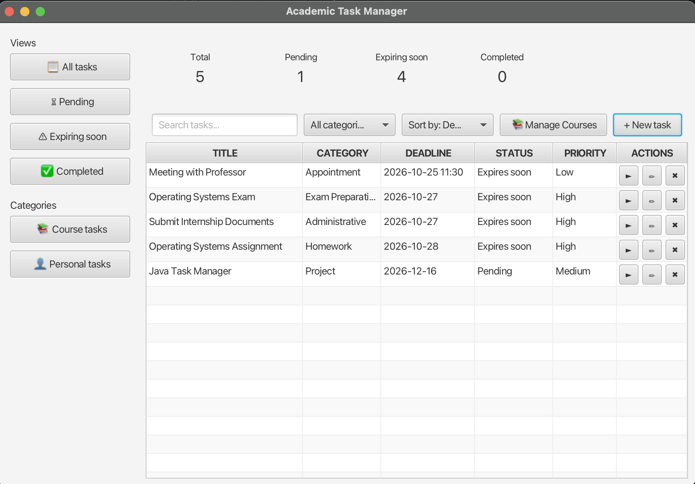
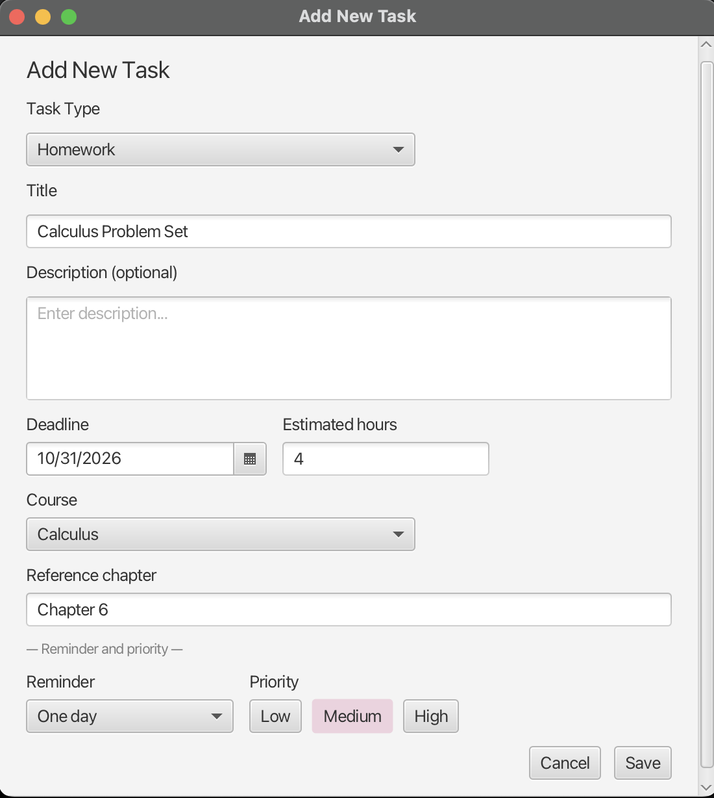
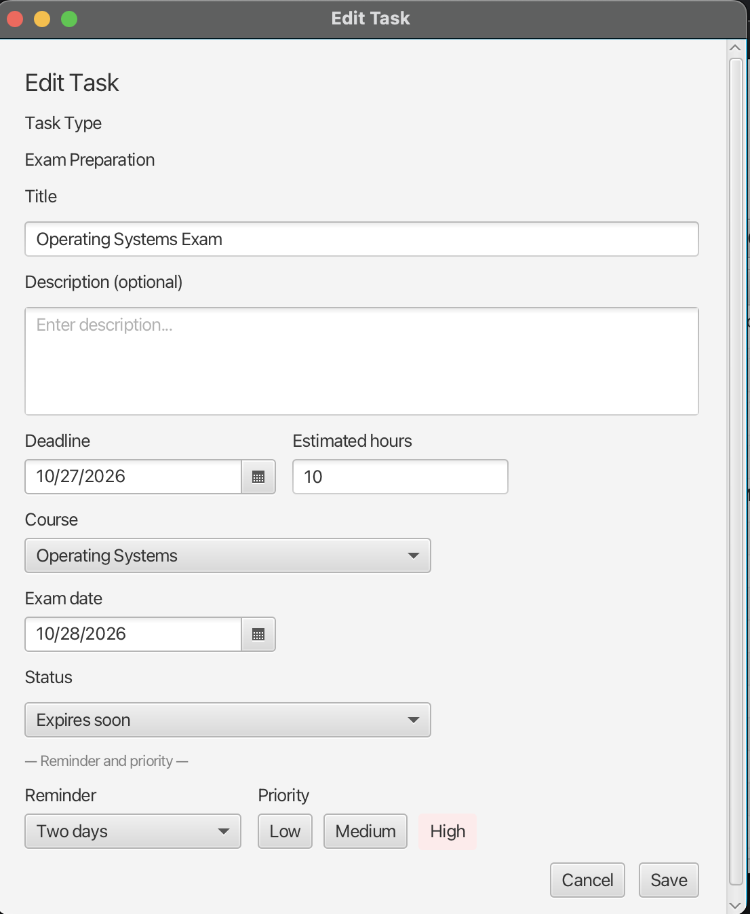
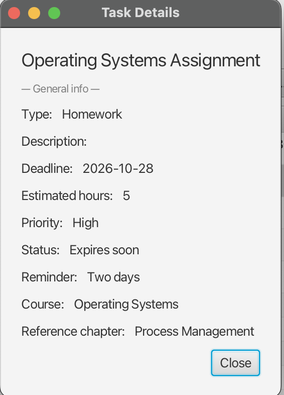

# Academic Task Manager

## Overview

Academic Task Manager is a desktop application built with Java and JavaFX that helps
students organize and manage their university-related tasks. Users can manage
their courses and create different types of course-related or personal tasks.

## Screenshots

### Main Dashboard



### Create Task



### Edit Task

 

### Task Details

   

## Features

- Create, edit, and delete tasks
- Support for multiple task types: Homework, Project, Exam Preparation, Appointment, and 
Administrative
- Organize tasks by course, deadline, and priority
- Add and manage courses through a course catalog
- Set reminders for approaching deadlines
- Search, filter, and sort tasks
- Store task and course data locally between application sessions

## Implementation

- Uses object-oriented programming principles, including abstraction,
  inheritance, and polymorphism, to model different task types
- Implements the user interface using JavaFX and FXML
- Stores courses and tasks locally in JSON files using Gson
- Separates application logic, data management, and UI controllers into distinct
  components

## Build

### Requirements

- Java 25 or later
- JavaFX dependencies are managed through Maven
- Maven Wrapper is included in the project

### Run

Clone the repository and navigate to the project directory:

```bash
git clone <https://github.com/xristosmxl7/academic-task-manager.git>
cd AcademicTaskManager
```

Run the application using the included Maven Wrapper:

```bash
./mvnw clean javafx:run
```

On Windows:

```bash
mvnw.cmd clean javafx:run
```

## Usage

After launching the application:

1. Add your university courses to the course catalog.
2. Create course-related or personal tasks and specify their details, such as deadline, 
priority, and reminder.
3. View and manage your tasks from the main dashboard.
4. Use search, filtering, and sorting options to organize and find tasks.
5. Edit or delete existing tasks as needed.

Application data is stored locally and remains available between sessions.

## Technologies

- Java
- JavaFX
- FXML
- Maven
- Gson
- JSON
